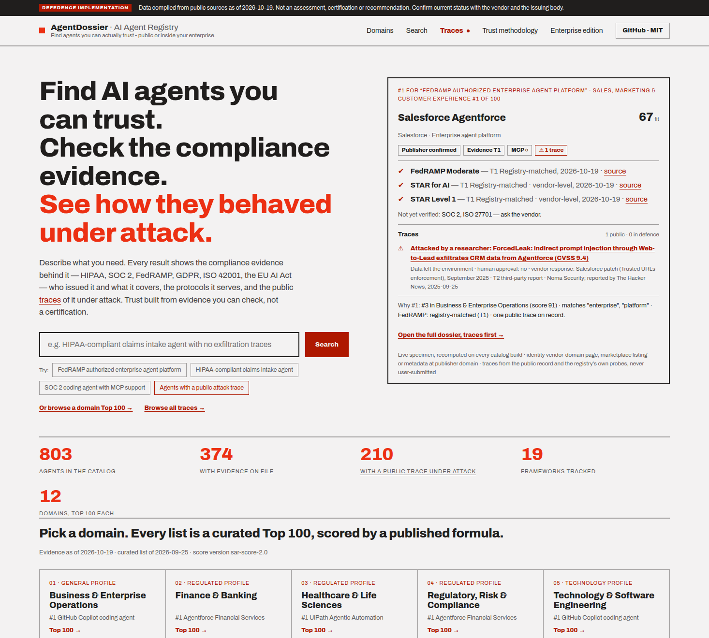
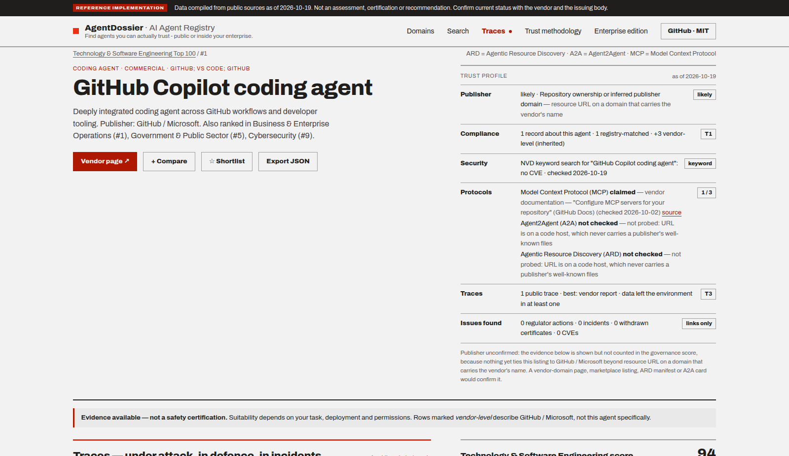
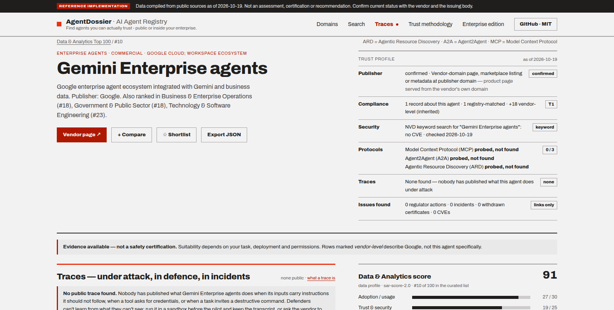

# AgentDossier

**An evidence dossier for every AI agent.** Discover AI agents. Inspect the evidence. Decide what fits your risk requirements.

AgentDossier is a vendor-neutral registry of AI agents that leads with
evidence instead of marketing. For each agent it shows what compliance and
trust evidence exists — HIPAA, SOC 2, FedRAMP, GDPR, ISO/IEC 42001, the EU AI
Act and more — who issued it, what it covers, whether it is still current and
what you still have to verify yourself. Agents are discovered through the open
standards they publish (Agentic Resource Discovery, Agent2Agent, Model Context
Protocol) as well as public registries and marketplaces, and the same engine
can scan an enterprise's own network for the agents already running there.

[](https://sushegaad.github.io/AgentDossier/)

- **Public demo:** https://sushegaad.github.io/AgentDossier/ — static, no accounts, no cookies; the demo build sends only aggregate, cookieless page counts
- **Self-hosted edition:** the same MIT codebase as one container with an authorized private-network scanner, ARD REST API, policy qualification, decision workflow and integrations
- **Worked comparison:** [three ways to let a coding agent into a private repository](https://sushegaad.github.io/AgentDossier/compare/coding-agents-private-repo/) — the same five deployment questions answered for six agents from their own documentation
- **Docs:** [`docs/methodology.md`](docs/methodology.md) (how evidence is graded), [`docs/traces.md`](docs/traces.md) and [`docs/traces-spec.md`](docs/traces-spec.md) (traces and vendor publishing), [`docs/incidents.md`](docs/incidents.md) (the incident registry and its weekly upkeep), [`docs/enterprise-runbook.md`](docs/enterprise-runbook.md) (run your own), [`docs/architecture.md`](docs/architecture.md), [`docs/brd-traceability.md`](docs/brd-traceability.md), [`CHANGELOG.md`](CHANGELOG.md)

### How it grades evidence

Every claim carries a tier and a date. The tier says *how* we know, not how
good the agent is:

| Tier | Meaning | Example |
|---|---|---|
| T1 | Registry-matched | found in the FedRAMP Marketplace or the CSA STAR registry on the stated date |
| T2 | Marketplace-listed | listed on a cloud marketplace that performs its own vetting |
| T3 | Document-evidenced | a certificate or report reviewed by a named maintainer |
| T4 | Vendor-claimed | stated on the vendor's trust page, not yet verified |
| T5 | No evidence found | shown as unknown — never as non-compliant |

Protocol support (MCP · A2A · ARD) is reported the same way: ✔ verified at
the publisher's endpoint, ○ documented by the vendor or named by the agent
itself, – probed and not found, ? never probed. Claims never outrank probes,
and evidence only counts toward an agent's score once the publisher's identity
is established. The full rules, with version numbers, are in
`docs/methodology.md`.

Every dossier opens with the trust profile and the line *Evidence available — not a
safety certification*; evidence about the vendor is kept apart from evidence about
the agent:

[](https://sushegaad.github.io/AgentDossier/agents/github-microsoft-github-copilot-coding-agent/)

[](https://sushegaad.github.io/AgentDossier/agents/google-gemini-enterprise-agents/)

## Example use case

An insurer's platform team is asked to pick a claims-intake agent and prove
to risk and legal that the choice was defensible.

1. **Search by intent.** On the demo, type *HIPAA-compliant claims intake agent*.
   The query becomes chips (compliance: HIPAA · domain: insurance · capability:
   claims intake) that you can edit, and every result shows its trust profile
   next to its relevance.
2. **Read the dossier.** Open the top result. The evidence ledger lists each
   framework with its issuer, scope, as-of date and a link to the source; the
   gaps line says what is still unverified; the protocol row says whether the
   agent can be wired in over MCP or A2A; the **Traces** section leads the
   dossier with what the agent did under attack — or says plainly that nobody
   has published that yet.
3. **Shortlist and compare.** Add three candidates to the shortlist, compare
   their score breakdowns side by side, and export CSV or JSON with the
   sources attached for the risk review.
4. **Qualify against policy (self-hosted).** The team's instance runs
   `POST /qualify` with the insurer's policy template; the verdict
   (eligible / needs review / disallowed) and the failing rules go into a
   decision record that security and legal sign off per role. The signed
   packet is exported to the GRC system, and the repository's
   `agents.lock.json` is checked on every pull request by the GitHub Action,
   so a later loss of evidence blocks the build instead of surprising an
   auditor.

## Quick start

Requirements: Python 3.11+, [uv](https://docs.astral.sh/uv/), Node 22 (for the site).

```bash
git clone https://github.com/Sushegaad/AgentDossier && cd AgentDossier
uv sync --extra dev
uv run pytest -q                                   # ~200 tests, all offline (includes the docs-drift check)

# build a catalog from the seed workbook only (no network)
uv run agentdossier build --sources seed --offline --out /tmp/catalog

# live build: registries, vendor trust pages and news for a small slice
uv run agentdossier build --sources seed,marketplaces --claim-domains 12 --news-limit 12 \
  --out /tmp/catalog --cache /tmp/cache

# run the site against it
cd web && npm ci && CATALOG_DIR=/tmp/catalog npm run dev
```

`--no-compliance` and `--no-news` skip those stages; `GITHUB_TOKEN` enables
the GitHub connector and release feeds and `NVD_API_KEY` lifts the NVD rate
limit. Hand-verified evidence, publisher-domain checks and documented
protocol support live in `data/curated/`. The public catalog is rebuilt every
Monday by `.github/workflows/refresh.yml` — which also scouts public feeds for
candidate incidents and re-checks every incident's source links — and the
result is opened as a reviewable pull request, then published through GitHub
Pages.

## Self-hosted edition

The enterprise edition finds the agents your teams already run — by reading
the ARD manifests, A2A agent cards and MCP server cards they publish — and
puts a governance surface around them. Nothing leaves your network.

```bash
uv sync --extra connectors --extra server --extra mcp
agentdossier enterprise selftest                                  # loopback end-to-end check
agentdossier enterprise preflight examples/enterprise/enterprise.json
agentdossier enterprise plan examples/enterprise/enterprise.json  # dry run for the change ticket
agentdossier enterprise scan examples/enterprise/enterprise.json
```

Run it as one container (`deploy/docker-compose.yml`, or the Helm chart in
`deploy/helm/agentdossier`); the image on GHCR is signed with cosign and
ships an SBOM. The instance serves:

- the web UI and the **ARD REST API** (`/.well-known/ard.json`, `POST /search` with federation to peer registries, `GET /agents`)
- **`POST /qualify`** — the machine constraint contract: a verdict per agent against a policy template or an inline policy
- the **decision workflow**: lifecycle with per-role sign-offs, comments, review tasks, feedback, and a decision packet export (JSON/CSV)
- **notifications and integrations**: email, signed webhooks, Slack, Teams, Jira, ServiceNow, a GRC webhook, and a GitHub Action that qualifies a repository's `agents.lock.json` on every pull request
- **identity**: OIDC with member/reviewer/admin roles, SCIM 2.0 provisioning, static tokens for service accounts; an MCP wrapper so internal agents can query the registry

The scanner refuses to run without an authorization record and only reaches
the CIDRs and hosts you list; every probe is written to a hash-chained audit
log. The operator guide is [`docs/enterprise-runbook.md`](docs/enterprise-runbook.md).

## Author

Hemant Naik — [LinkedIn](https://www.linkedin.com/in/tanaji-naik/) · [hemant.naik@gmail.com](mailto:hemant.naik@gmail.com)

Built October 2026 as a reference implementation. Issues and pull requests
are welcome; see `CONTRIBUTING.md` and `SECURITY.md` for reporting a
vulnerability.

## License and disclaimer

Code is released under the MIT License (see `LICENSE`). The compiled catalog
data is CC BY 4.0 with per-record source attribution. Third-party files keep
their own licenses; see `THIRD_PARTY_NOTICES.md`.

AgentDossier compiles information from public sources as of the date shown
on each record. It is **not** an assessment, certification, legal opinion or
recommendation, and no vendor or issuing body has endorsed it. Evidence can
expire or be withdrawn after it was collected; absence of evidence means only
that none was found in the sources checked. Confirm current status with the
vendor and the issuing body before relying on it.

## Business use cases, features, and design

### Who it is for and why

AI agents are entering regulated workflows faster than the evidence to govern
them. A buyer asked to approve one usually has a vendor's marketing page and
little else, and "we red-teamed it" is taken on faith. AgentDossier exists to
put the evidence — and the honest gaps — in front of the people who have to
decide.

- **Procurement and vendor risk.** Shortlist agents for a regulated use case
  and see, per agent, which frameworks are backed by a registry or a document
  versus only claimed on a vendor page, what is still unknown, and the
  restrictions a bounded pilot should carry. The worked comparisons answer the
  same deployment questions for a set of agents from their own documentation.
- **Security and GRC teams.** Read the publisher-identity tier, the protocol
  posture (verified / documented / none), the CVE keyword check, and — the part
  the market lacks most — public **traces** of the agent under prompt injection
  and tool abuse. "No public trace found" is stated plainly rather than hidden.
- **Platform and enterprise architecture.** Run the same engine against your
  own network to inventory the agents already deployed, qualify them against a
  policy, and route them through a decision workflow whose approval can be
  **gated on a trace** — an agent cannot be approved until it has actually been
  watched under attack.
- **Agent builders and vendors.** See how your agent appears to a careful
  buyer, dispute or correct a dossier, and publish your own evaluation traces
  through the open ARD extension so your evidence is machine-checkable.

### Current features

- **Evidence-first dossiers.** Compliance evidence tiered T1–T5 with issuer,
  scope, date and freshness; agent-level versus vendor-level (inherited)
  evidence kept separate so a vendor certificate never reads as a blanket
  endorsement of every agent it offers.
- **Publisher identity** (`identity-1.1`): confirmed / likely / unconfirmed /
  unknown, with compliance credited only once the publisher is confirmed.
- **Protocol posture** from live probes of ARD, A2A and MCP well-known
  endpoints, plus curated and self-described claims.
- **Traces — under attack, in defence, in incidents.** An **incident
  registry** (`/traces/`): one row per real, sourced event where an AI agent
  attacked, defended or was the target, with a timeline, MITRE ATT&CK tactics,
  what defenders can take from it, and STIX 2.1 / JSON export. A weekly
  **scout** reads public feeds and files candidates for a maintainer to promote
  or dismiss, and a weekly **re-check** records whether every source link still
  answers. Per agent: curated write-ups, the registry's own reproducible probe
  transcripts, and an ARD extension for vendors to publish their own; every
  bundle lives in an append-only, hash-chained store. A sandbox **harness** that
  runs agents against the AgentDojo prompt-injection benchmark is wired in and
  tested, and produces tier-1 traces once a model-provider key is configured —
  until then no public harness trace exists, and the site says so.
  See [`docs/incidents.md`](docs/incidents.md).
- **Discovery and curation.** A curated Top 100 per domain plus agents
  discovered from GitHub, Hugging Face, the MCP registry, marketplaces and ARD
  manifests, with demo, deprecated and abandoned projects filtered out.
- **Scoring** (`sar-score-2.0`): seven weighted components per domain profile;
  trust and governance recomputed from evidence on every build, shown beside
  the curated rank rather than used to reorder it. Scores are discovery
  signals, not certification.
- **"Before you deploy"** restrictions derived from the evidence, reference-set
  answers and rules — including *run your own sandbox trace when none is
  public* and *keep an egress allowlist when a trace shows data leaving*.
- **Self-hosted enterprise edition**: authorized private-network scanner, ARD
  REST API, policy qualification, decision workflow with sign-offs and the
  trace gate, hash-chained audit log, SCIM deprovisioning and integrations.

### Technical design

- **Static public core.** A Python pipeline (`agentdossier build`) compiles a
  catalog of JSON records; an Astro + React site renders them as a fully static
  site with no backend and no accounts. The weekly refresh runs in CI and opens
  a reviewable pull request — the data is never edited in place.
- **Provenance over assertion.** Every record carries its source, date and a
  tier that says *how* it is known. Protocol and trace artifacts are fetched,
  validated and hashed; a web page served where a JSON document was expected is
  recorded as "not found", not as a broken artifact.
- **Append-only, verifiable trace store.** `data/traces/` is a hash-chained
  ledger (`index.jsonl`) plus text bundles; each line carries the hash of the
  line before it, so an edited or removed trace breaks the chain, and CI
  verifies it on every change. `git clone` is the mirror.
- **Honest scales.** Compliance uses T1–T5; publisher identity, protocol status
  and the security check each use plain words rather than borrowing that scale,
  and "unknown / none found" is never rendered as a negative finding.
- **Shared engine, two editions.** The same code powers the public catalog and
  the self-hosted scanner; the enterprise edition adds a FastAPI server, a
  SQLite instance database and fail-closed authentication, and keeps private
  data inside the tenant unless it is explicitly published.
- **Standards-based.** Agents are discovered and described through Agentic
  Resource Discovery, Agent2Agent and the Model Context Protocol; the trace and
  vendor-publishing conventions are documented in
  [`docs/traces.md`](docs/traces.md) and [`docs/traces-spec.md`](docs/traces-spec.md).

- **Docs that cannot silently go stale.** `scripts/check_docs_drift.py` runs in
  CI and under `pytest`: the test count, Python and Node versions across the
  README, CI matrix and Dockerfile, the docs index, and the incident counts are
  verified against the repository on every change.

See [`docs/architecture.md`](docs/architecture.md) and
[`docs/methodology.md`](docs/methodology.md) for the full design and grading
rules.
